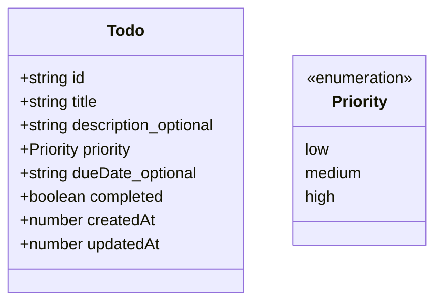
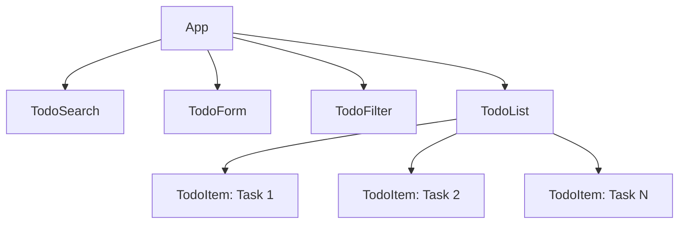

# Todo App — Feature Specification

Source repository: [github.com/CS-git-1/smart-todo-curd](https://github.com/CS-git-1/smart-todo-curd)

> Historical UI specification from before backend integration. The active app now requires sign-in and persists tasks through the authenticated API; localStorage-only persistence and Undo behavior below are not current behavior.

เอกสารข้อกำหนดฟีเจอร์และพฤติกรรมของ Smart Todo โดยยึด Data Model และเงื่อนไขจากสเปกอาจารย์

## 1. Data Model: Task

```ts
type Priority = "low" | "medium" | "high";
type FilterStatus = "all" | "active" | "completed";
type FilterPriority = "all" | Priority;

interface Todo {
    id: string;
    title: string;
    description?: string;
    priority: Priority;
    dueDate?: string;
    completed: boolean;
    createdAt: number;
    updatedAt: number;
}
```

| Field | Required | กฎ/รายละเอียด |
| --- | --- | --- |
| `id` | ใช่ | string ที่ไม่ซ้ำ; สร้างเป็น UUID หรือ timestamp |
| `title` | ใช่ | string; trim แล้วต้องไม่ว่าง และมีความยาว 1–100 ตัวอักษร |
| `description` | ไม่ | string สำหรับรายละเอียดสั้น ๆ |
| `priority` | ใช่ | รับเฉพาะ `low`, `medium`, `high` |
| `dueDate` | ไม่ | ISO date string หรือ `YYYY-MM-DD`; อนุญาตให้ไม่ระบุ |
| `completed` | ใช่ | boolean; `false` คือ Active, `true` คือ Done |
| `createdAt` | ใช่ | number timestamp; กำหนดด้วย `Date.now()` เมื่อสร้าง task |
| `updatedAt` | ใช่ | number timestamp; ตั้งตอนสร้าง task และเปลี่ยนทุกครั้งที่แก้ข้อมูล task |

task ใหม่ต้องมี `completed: false` และค่า priority ที่ถูกต้อง UI แสดง Active/Done และขีดฆ่าชื่องานเมื่อ Done

### Data Model Diagram



### Due Date Behavior

| ค่า `dueDate` | พฤติกรรม |
| --- | --- |
| ไม่ระบุ / `null` | อนุญาตให้บันทึก task ได้ ไม่แสดงวันกำหนดส่งในรายการ และไม่นับว่าเลยกำหนด |
| วันที่วันนี้หรืออนาคต (`YYYY-MM-DD`) | อนุญาตให้บันทึก และแสดงเป็นวันที่อ่านง่าย |
| วันที่ผ่านมา (`YYYY-MM-DD`) | อนุญาตให้บันทึกและแสดงวันที่ พร้อมระบุว่าเลยกำหนดเมื่อ task ยังไม่ Done |
| รูปแบบไม่ถูกต้องหรือไม่มีวันที่จริง | ไม่อนุญาตให้เพิ่ม task และแจ้ง validation error |

วันที่เลยกำหนดไม่เปลี่ยน `completed` โดยอัตโนมัติ; สถานะยังเปลี่ยนด้วยการกระทำของผู้ใช้เท่านั้น

## 2. Search

- รับ keyword ในช่องค้นหา; ใช้ค่าค้นหาหลังผู้ใช้กดปุ่ม “ค้นหา” หรือกด Enter
- แปลง keyword และ `title`/`description` เป็น lower case เพื่อค้นหาโดยไม่สนตัวพิมพ์เล็ก/ใหญ่
- ค้นหาเฉพาะ `title` หรือ `description`
- keyword ว่างหรือมีแต่ช่องว่างไม่กรองรายการเพิ่ม แต่ยังใช้ status/priority filter ที่เลือกอยู่
- ค่าที่กำลังพิมพ์ในช่องเป็น draft; รายการจะยังไม่กรองจนกว่าจะ submit ด้วยปุ่มหรือ Enter

## 3. Filter

### Status

- `all`: แสดงทุกสถานะ
- `active`: แสดงเฉพาะ `completed === false`
- `completed`: แสดงเฉพาะ `completed === true`

### Priority

- `all`: แสดงทุกระดับ
- `high`: แสดงเฉพาะ priority สูง
- `medium`: แสดงเฉพาะ priority ปานกลาง
- `low`: แสดงเฉพาะ priority ต่ำ

### เงื่อนไขร่วม

- รวม Search Keyword, Status Filter และ Priority Filter ด้วยตรรกะ AND
- แสดงจำนวน task ที่ตรงกับเงื่อนไขทั้งหมด
- เมื่อรายการหลังกรองว่าง ให้แสดง empty state “ไม่พบรายการที่ตรงกับเงื่อนไขการค้นหาหรือตัวกรอง”; ข้อความเดียวกันใช้ทั้งกรณีไม่มี task ใน state และกรณีมี task แต่ไม่ตรงตัวกรอง

## 4. Core Features

1. Task มี title และ description แบบไม่บังคับ
2. Priority ใช้ `low` / `medium` / `high` และแสดง badge แยกตามระดับ
3. Due Date ใช้ระบุวันกำหนดเสร็จและแสดงในรูปแบบที่อ่านง่าย
4. Status เก็บเป็น `completed: boolean`; UI แสดง Active หรือ Done
5. ผู้สอนสาธิต Search/Filter หลังจบ CP5

### Required Demo Flow: Add → List → Toggle → Delete Until Empty

การสาธิตหลักให้ใช้ task ที่ผู้สอนเพิ่มเองผ่านหน้าเว็บ และทำตามลำดับนี้:

1. **Add** — กรอก title ใน `TodoForm` แล้วกดเพิ่ม; task ใหม่ต้องมี `completed: false` และปรากฏใน state ของ `App`.
2. **List** — ตรวจว่า title ที่เพิ่งเพิ่มปรากฏเป็นแถวใน `TodoList`; นี่คือการยืนยันการอ่านและ render state ไม่ใช่เพียงข้อความตอบกลับจากฟอร์ม.
3. **Toggle** — กดปุ่มวงกลมของแถวนั้น; แถวนั้นต้องเปลี่ยนจาก Active เป็น Done (หรือย้อนกลับได้) โดย task อื่นไม่เปลี่ยน.
4. **Delete** — กดลบตามแถว; task ที่เลือกหายจาก `TodoList` ทันทีและมีปุ่ม Undo ให้กู้คืนภายใน 10 วินาที.
5. **Empty** — ลบ task ที่เหลือทั้งหมด และตรวจว่า `TodoList` แสดง empty state.

เพื่อให้การตรวจ Empty ชัดเจน ให้ลบรายการตัวอย่างที่แสดงเมื่อเริ่มครั้งแรก หรือรายการเดิมที่โหลดจาก `localStorage` ก่อนเริ่ม flow. หากมี Search หรือ Filter ค้างอยู่ ให้คืนเป็นคำค้นหาว่าง, status `all` และ priority `all` ก่อนลบจนหมด เพื่อไม่ให้ empty state เกิดจากการกรองแทนการไม่มีข้อมูล.

การลบราย task และการล้างงานที่เสร็จแล้วใช้ Undo 10 วินาทีแทนกล่องยืนยัน; งานที่ลบถูกซ่อนจากรายการทันทีและเก็บใน `undoBatch` ชั่วคราว. หากกด Undo ภายในเวลา งานใน batch ปัจจุบันจะกลับมา; เมื่อหมดเวลา batch จะถูกทิ้งและ state ปัจจุบันที่ไม่มีงานเหล่านั้นจะถูกบันทึกใน `localStorage`.

### Delete UX and trade-off

- ข้อความแจ้ง: “ลบแล้ว N รายการ — กู้คืนได้ภายใน 10 วินาที” พร้อมปุ่ม `Undo`; เมื่อกู้คืนแสดง “กู้คืนงาน N รายการแล้ว”.
- **ลบจริงหลังช่วง Undo:** โครงสร้างง่าย ไม่มีถังขยะถาวร และ state/localStorage ไม่มีรายการที่ลบหลังหมดเวลา; ข้อเสียคือกู้คืนหลัง 10 วินาทีไม่ได้.
- **Soft delete (`deletedAt`/`deleted`):** เก็บรายการที่ลบไว้และซ่อนจากรายการปกติ ทำให้กู้คืนภายหลังได้; ข้อเสียคือต้องเพิ่มการจัดการถังขยะ/ลบถาวร และข้อมูลสะสมใน storage.
- เวอร์ชันปัจจุบันใช้แนวทางแรก โดยเก็บสำเนาชั่วคราวใน React state สำหรับ Undo; ไม่ใช่ soft delete ที่คงอยู่หลัง reload หรือปิดแท็บ.

### Demo Verification Record

| ขั้น | หลักฐานที่ต้องเห็นบนหน้าเว็บ | ผล |
| --- | --- | --- |
| Add | ฟอร์มรับ title และแสดงข้อความยืนยันเพิ่มงาน | ☐ |
| List | task ที่เพิ่มปรากฏเป็นแถวพร้อม title | ☐ |
| Toggle | แถวเป้าหมายแสดง Done/รูปแบบ completed | ☐ |
| Delete | task หายและมีปุ่ม Undo 10 วินาที | ☐ |
| Undo/Expire | กู้คืนได้ก่อนครบเวลา; เมื่อหมดเวลาปุ่มหายและ task คงถูกลบ | ☐ |
| Empty | ไม่มี task เหลือและ Undo หมดเวลาแล้ว | ☐ |

บันทึก screenshot หลัง Add/List, หลัง Toggle และเมื่อถึง Empty โดยให้เห็นผลที่สังเกตได้ในแต่ละภาพ และเก็บไฟล์หลักฐานไว้ในโฟลเดอร์เอกสารของโปรเจกต์.

## 5. Acceptance Criteria

| ID | เกณฑ์ | ผลที่คาดหวัง |
| --- | --- | --- |
| AC-00 | Add → List | task ที่เพิ่มผ่านฟอร์มปรากฏใน TodoList |
| AC-01 | Title ว่างหรือมีแต่ whitespace | เพิ่ม task ไม่ได้ และแจ้งเตือนหรือปิดการเพิ่ม |
| AC-02 | Toggle status | สลับ Active/Done ได้ และเปลี่ยนเฉพาะ task ที่เลือก |
| AC-02a | Delete by ID | task ที่เลือกหายไป โดย task อื่นยังอยู่ |
| AC-03 | Keyword Search | รายการกรองจาก title/description โดยไม่สนตัวพิมพ์เล็ก/ใหญ่ |
| AC-04 | Priority Filter | เลือก all/high/medium/low ได้ถูกต้อง |
| AC-05 | Readable Due Date | แสดงวันในรูปแบบอ่านง่าย ไม่แสดง raw date string |
| AC-06 | Combined filters | Search, status และ priority ทำงานร่วมกันด้วย AND |
| AC-07 | Match counter | จำนวนตรงกับรายการที่แสดงหลังกรอง |
| AC-08 | Empty state | เมื่อผลหลัง search/filter ว่าง แสดงข้อความแจ้งว่าไม่พบรายการตามเงื่อนไข |

## 6. Component Mapping

```text
App
├── TodoSearch
├── TodoForm (title, description, priority, dueDate)
├── TodoFilter (status, priority, counts, clear completed)
└── TodoList (ผลลัพธ์และ empty state)
    └── TodoItem (checkbox, title, priority badge, dueDate, actions)
```

### State ownership และ derived data

| State ใน `App` | Type | หน้าที่ |
| --- | --- | --- |
| `todos` | `Todo[]` | Single source of truth; sync กับ `localStorage` |
| `searchKeyword` | `string` | คำค้นหาที่ submit แล้ว ใช้กรอง title/description |
| `statusFilter` | `FilterStatus` | เงื่อนไขกรองสถานะ |
| `priorityFilter` | `FilterPriority` | เงื่อนไขกรองระดับความสำคัญ |

- `filteredTodos` คำนวณจาก todos โดยรวม keyword, status และ priority ด้วย AND
- `counts` คำนวณ `all`, `active`, `completed` จาก todos เพื่อส่งให้ `TodoFilter`
- `TodoForm` เก็บค่าช่องกรอกชั่วคราวด้วย local UI state
- `TodoSearch` เก็บคำค้นหา draft ใน local UI state และส่งให้ `App` เมื่อ submit ด้วยปุ่มหรือ Enter
- `TodoItem` เก็บ `isEditing` และ `editFields` เฉพาะแถว
- `TodoList` และ `TodoFilter` ไม่เป็นเจ้าของ business state; `TodoSearch` มีเฉพาะ draft state

### Props และ callbacks

- `TodoSearch`: `keyword`, `onSearchChange(keyword)`
- `TodoForm`: `onAddTodo(payload)`
- `TodoFilter`: `currentStatus`, `currentPriority`, `counts`, `onStatusChange`, `onPriorityChange`, `onClearCompleted`
- `TodoList`: `todos`, `onToggle`, `onDelete`, `onEdit`
- `TodoItem`: `todo`, `onToggle(id)`, `onDelete(id)`, `onEdit(id, changes)`

`App` เป็นเจ้าของ todos state; child ส่ง event ผ่าน callbacks และไม่แก้ state หลักโดยตรง ส่วน `updatedAt` เป็น field ต่อเติมของแอป ใช้ timestamp ตัวเลขและอัปเดตเมื่อแก้ไข task

## 7. Component Tree และ Component Responsibilities



```text
App (Container / State Owner)
├── TodoSearch
├── TodoForm
├── TodoFilter
└── TodoList
    ├── TodoItem (Task 1)
    ├── TodoItem (Task 2)
    └── TodoItem (Task N...)
```

| Component | Props ที่รับ | State ภายใน | Event / Callback |
| --- | --- | --- | --- |
| `App` | ไม่มี | `todos`, `searchKeyword`, `statusFilter`, `priorityFilter`, message state | เป็นเจ้าของ handlers สำหรับ add, toggle, delete, edit, filter และ clear completed |
| `TodoSearch` | `keyword`, `onSearchChange` | `draft` | เรียก `onSearchChange(draft)` เมื่อ submit ผ่านปุ่มค้นหาหรือ Enter |
| `TodoForm` | `onAddTodo` | `fields` ของฟอร์ม: title, description, priority, dueDate | เรียก `onAddTodo(payload)` เมื่อ submit |
| `TodoFilter` | `currentStatus`, `currentPriority`, `counts`, `onStatusChange`, `onPriorityChange`, `onClearCompleted` | ไม่มี | ส่งค่าตัวกรองที่เลือก หรือเรียก clear completed กลับไปยัง `App` |
| `TodoList` | `todos`, `onToggle`, `onDelete`, `onEdit`, `priorityLabels` | ไม่มี | map `todos` เป็น `TodoItem` และส่ง callbacks ต่อ |
| `TodoItem` | `todo`, `onToggle`, `onDelete`, `onEdit`, `priorityLabels` | `isEditing`, `editFields` | เรียก `onToggle(todo.id)`, `onDelete(todo.id)`, `onEdit(todo.id, changes)` |

### Data and Event Flow

1. `App` ส่ง `todos` ที่ผ่านการค้นหาและกรองลงไปให้ `TodoList` ผ่าน prop `todos`.
2. `TodoList` ส่ง `todo` แต่ละรายการและ callbacks ต่อให้ `TodoItem`.
3. เมื่อผู้ใช้ toggle, delete หรือ edit, `TodoItem` เรียก callback พร้อม `todo.id`; การลบซ่อน task และเปิดช่วง Undo 10 วินาที.
4. `TodoList` ส่ง callback ต่อโดยไม่แก้ข้อมูลเอง; `App` เป็นผู้เปลี่ยน state ตาม ID แล้ว React render props ชุดใหม่ลงมา.

### Components Without Business State

`TodoList` และ `TodoFilter` ไม่มี state ภายใน ทำหน้าที่แสดงข้อมูลและส่ง events ผ่าน callbacks. `TodoSearch` มี local draft state สำหรับข้อความที่ยังไม่ submit. `TodoForm` และ `TodoItem` มี local UI state สำหรับค่าฟอร์มและโหมดแก้ไขตามลำดับ; state ของรายการงานยังอยู่ที่ `App`.
